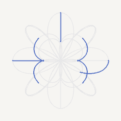
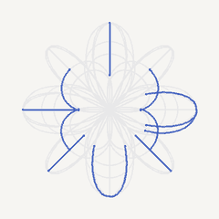
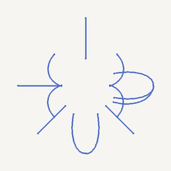

# Motion Lab

A lightweight, agent-friendly toolkit for building expressive mascot motion,
alongside a gallery of loading indicator experiments.

The project is licensed under MIT; see [LICENSE](LICENSE). See
[CONTRIBUTING.md](CONTRIBUTING.md) to contribute and [SECURITY.md](SECURITY.md)
to report a vulnerability privately.

## Mascot Motion Toolkit

Give your coding agent the code, files, snippets, or project context you want to
animate, then describe the motion. The agent should work in the existing
language and framework, update the appropriate source, and test the result.
Images are optional; the Studio upload is only for previewing artwork or
exporting reusable scene assets. Manual image splitting and pivot marking are
not required.

- [Open Mascot Motion Studio](src/studio/mascot-motion-studio.html)
- [Read the coding-agent workflow](AGENTS.md)
- [Use the animation runtime](src/runtime/mascot-motion.js)

The runtime supports keyframed translation, squash-and-stretch, opacity,
rotation on all three axes, perspective, parented image layers, and reduced
motion preferences. High-quality articulation works best with separated,
transparent artwork parts.

### M1 verification harness

Install dependencies and Chromium once with `npm ci` and
`npx playwright install chromium`. Then run `npm run verify` to test runtime
seeking, validate the example scene and its assets, check motion bounds, and
render deterministic frames with a PNG/SVG contact sheet. The PNG contact
sheet is written to `frames/verify/contact-sheet.png`; `frames/` is ignored by
Git. Use `SKIP_BROWSER=1 npm test` or `SKIP_BROWSER=1 npm run verify` to skip
browser checks when Chromium is unavailable. Use
`npm run validate-scene -- --scene scene.json`,
`npm run check-motion -- --scene scene.json`, and
`npm run frames -- --scene scene.json --anim idle --debug` for individual checks.

Scenes use schema version 1, defined in [schema/scene.schema.json](schema/scene.schema.json);
see [docs/scene-format.md](docs/scene-format.md) for compatibility and migration
guidance.
Scenes without a `version` field are treated as version 1 for backward
compatibility; unsupported explicit versions are rejected.

## Loading Indicator Gallery

Each loading indicator has a standalone HTML demo and two animated previews:
the complete outline on the left and only the moving blue traces on the right.

## Gallery

### 01 · Four Petals

Four soft loops form a flower. The shape stays still while a single light trace
moves along its outline.

  
  &nbsp;&nbsp;
  

[View in browser](examples/loading-indicators/loading-indicator.html)

---

### 02 · Four Petals — 360°

The flower slowly rotates around its vertical (Y) axis. A light trace travels
along the outline to emphasize its depth.

  
  &nbsp;&nbsp;
  

[View in browser](examples/loading-indicators/loading-indicator-360.html)

---

### 03 · Four Petals — Crossed 360°

Two flower planes intersect at right angles and rotate together through 360°.
A separate, slightly offset light trace moves along each plane.

  
  &nbsp;&nbsp;
  

[View in browser](examples/loading-indicators/loading-indicator-crossed-360.html)

---

### 04 · Four Petals — Orbital Triad 360°

Three flower planes form an orthogonal cross. They remain rigidly aligned and
rotate together around a space diagonal.

  
  &nbsp;&nbsp;
  

[View in browser](examples/loading-indicators/loading-indicator-triad-360.html)

---

### 05 · Four Petals — Octahedral Seven 360°

Four additional planes are perpendicular to the four body diagonals, joining
the orthogonal three-plane cross. All seven planes remain rigidly aligned and
rotate together around a space diagonal.

  
  &nbsp;&nbsp;
  

[View in browser](examples/loading-indicators/loading-indicator-octahedral-360.html)

---

### 06 · Four Petals — Cubic Thirteen 360°

Six additional planes, perpendicular to the cube's face diagonals, complete
the 13-plane symmetric arrangement. All planes stay rigidly aligned as they
rotate together through 360°.

  
  &nbsp;&nbsp;
  

[View in browser](examples/loading-indicators/loading-indicator-cubic-360.html)
