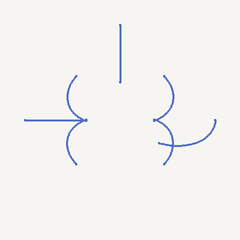

# just playin' around

Eine kleine, wachsende Sammlung verspielter Ladesymbole — jedes Experiment als
eigenständige HTML-Datei und mit zwei animierten Vorschauen: links das Symbol
mit Kontur, rechts nur die bewegten blauen Linien.

## Galerie

### 01 · Four Petals

Vier weiche Schleifen formen eine Blüte. Das Symbol bleibt ruhig in der Ebene,
während ein einzelner Lichtstrich die Kontur entlangwandert.

  
  &nbsp;&nbsp;
  

[Im Browser ausprobieren](loading-indicator.html)

---

### 02 · Four Petals — 360°

Dieselbe Blüte dreht sich langsam um ihre senkrechte Achse (Y-Achse). Dabei
wandert ein Lichtstrich über die Kontur und betont ihre räumliche Tiefe.

  
  &nbsp;&nbsp;
  

[Im Browser ausprobieren](loading-indicator-360.html)

---

### 03 · Four Petals — Crossed 360°

Zwei Blütenebenen stehen im rechten Winkel zueinander und drehen sich gemeinsam
um 360°. Auf jeder Ebene wandert ein eigener, leicht versetzter Lichtstrich.

  
  &nbsp;&nbsp;
  

[Im Browser ausprobieren](loading-indicator-crossed-360.html)

---

### 04 · Four Petals — Orbital Triad 360°

Drei Blütenebenen stehen im rechten Winkel zueinander und vervollständigen
das Raumkreuz. Sie bleiben starr zueinander und drehen sich gemeinsam um die
Raumdiagonale.

  
  &nbsp;&nbsp;
  

[Im Browser ausprobieren](loading-indicator-triad-360.html)

---

### 05 · Four Petals — Octahedral Seven 360°

Vier Ebenen entlang der Raumdiagonalen ergänzen das orthogonale Dreierkreuz.
Alle sieben Ebenen bleiben starr gekoppelt und drehen sich gemeinsam um eine
Raumdiagonale.

  
  &nbsp;&nbsp;
  

[Im Browser ausprobieren](loading-indicator-octahedral-360.html)

---

Neue Experimente bekommen jeweils eine eigene HTML-Datei und eine passende
GIF-Vorschau unter `assets/`.
